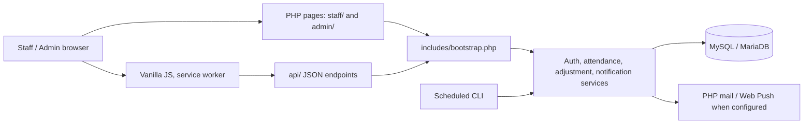

# Staff Attendance System: product and technical review

Review basis: repository working tree on 13 November 2026. This is a static source review. No database, web server, browser, or test suite was run. The working tree already contained many uncommitted changes; this report describes the files as found. "Implemented" means a code path exists, not that production behavior was verified.

## Executive summary

This is an internal PHP/MySQL workforce attendance web application for a Malaysian retail or store organization. Staff record shifts and breaks, request leave or corrections, and review their history. Admins manage people, schedules, offices, exceptions, and reports. Its strongest engineering work is around attendance auditability: row locking, correction reviews, break discrepancy handling, and retry reconciliation. The largest current risk is release consistency: the fresh-install schemas omit the `attendance_idempotency_operations` table required by the newer attendance browser path. Runtime readiness, browser usability, and live integration behavior remain **Unverified**.

## 1. Product overview

The product serves staff and admin/manager roles through server-rendered responsive web pages, with progressive-web-app assets. It addresses manual timekeeping, missing break records, schedule exceptions, and disputed records. A staff journey is login → dashboard → clock in → start/end permitted breaks → clock out → inspect history or request correction. An admin journey is login → review daily activity/exceptions → decide leave and correction requests → manage staff/schedules/offices → export reports. The system looks feature-rich but still depends on careful deployment and manual operational checks, so maturity is best described as **advanced internal application, production readiness unverified**. Evidence: [README](../README.md), [staff dashboard](../staff/index.php), [admin dashboard](../admin/index.php), [navigation](../includes/sidebar.php).

## 2. Feature inventory

Status terms below describe repository implementation only. Every feature's live operation is unverified.

| Feature and status | User flow and implementation | Data and limits |
|---|---|---|
| Login, remember session, role access — implemented | [login](../index.php), [auth](../includes/auth.php), [rate limiter](../includes/rate_limiter.php); admins enter `admin/`, staff enter `staff/` | `users`, `auth_remember_tokens`, `login_rate_limits`; staff-area guard uses `require_login`, while `require_staff` also permits admins. No finer role permissions. |
| Invitation, password reset, email verification — implemented with conditional delivery | [account recovery](../includes/account_recovery.php), [setup](../setup_account.php), [forgot](../forgot_password.php), [reset](../reset_password.php), [staff admin form](../admin/staff_form.php) | `account_recovery_tokens`; automatic email requires configured PHP mail. Manual link handoff is supported; delivery and identity-check process are unverified. |
| Clock in/out and live state — implemented | [staff dashboard](../staff/index.php), [browser controller](../assets/js/app.js), [clock API](../api/clock.php), [service](../includes/attendance_service.php#L1913) | `attendance`, `attendance_audit_logs`; one user/date row, Malaysia timezone, no demonstrated overnight-shift model. |
| Breaks and discrepancy review — implemented | [break API](../api/break.php), [service](../includes/attendance_service.php#L2021), [staff history](../staff/breaks.php), [admin review](../admin/breaks.php) | `break_records`, `attendance`; lunch 1×60m, solat 3×20m, short 3×10m suggestions. Open breaks auto-close on clock-out and enter review. |
| Retry-safe attendance operations — partially deployed | [reliability JS](../assets/js/attendance_reliability.js), [state API](../api/attendance_operation.php), [idempotency service](../includes/idempotency_service.php), [migration](../database/migration_phase3b_idempotency.sql) | Requires a separate migration absent from fresh schemas; endpoint reports unavailable when table is missing. Legacy unkeyed POST paths remain in clock/break APIs. |
| Schedule and off-day management — implemented | [admin schedules](../admin/schedules.php), [staff schedule](../staff/schedule.php), [service](../includes/attendance_service.php#L33) | `work_schedules`, `schedule_assignments`, weekly off day on `users`; historical assignment dates exist. |
| Leave and WFH requests — implemented | [staff leave](../staff/leave.php), [admin leave](../admin/leave_requests.php), [service](../includes/attendance_service.php#L267) | `leave_requests`, `attendance`; module can be hidden by setting. External HR/payroll integration unverified. |
| Attendance/break correction and audit — implemented | [staff corrections](../staff/corrections.php), [admin corrections](../admin/corrections.php), [service](../includes/attendance_service.php#L356) | `attendance_correction_requests`, `attendance_audit_logs`, `break_records`; review logic is large and tightly centralized. |
| Replacement off-day balance — implemented | [admin adjustments](../admin/offday_adjustments.php), [adjustment service](../includes/adjustment_service.php) | `offday_adjustment_reviews`, `leave_replacement_reviews`, `staff_balance_ledger`; approval/reversal paths exist. |
| Offices and optional location evidence — implemented | [office form](../admin/office_form.php), [location service](../includes/attendance_location.php), [clock API](../api/clock.php) | `offices`, `attendance_location_events`; browser permission, HTTPS, accuracy, and user preference affect capture. Location is evidence, not verified physical presence. |
| Notifications and browser push — implemented with integration dependency | [notification service](../includes/notification_service.php), [push API](../api/push_subscription.php), [push service](../includes/push_service.php), [service worker](../sw.js) | `notifications`, `push_subscriptions`; VAPID and browser support needed. Delivery success is unverified. |
| Reports and CSV/Excel/PDF — implemented | [admin reports](../admin/reports.php), [export](../includes/report_export.php) | Attendance, breaks, leave and discrepancy data; PDF is browser-generated via `html2pdf`, so output fidelity needs browser testing. |
| Languages, theme, PWA shell — implemented | [i18n](../includes/i18n.php), [language files](../assets/lang/en.php), [layout](../includes/layout_header.php), [service worker](../sw.js) | English/Malay/Chinese keys, local theme preference, cached assets. Translation completeness and offline workflow are unverified. |

Older scripts under `scratch/`, demo seed/reset scripts under `database/` and `cli/`, and evidence folders are development/operations material rather than user features. [README](../README.md) explicitly retires `database/update_today_records.php`.

## 3. Architecture and technical reference

PHP 8+ server pages render HTML with Bootstrap 5 and vanilla JS; there is no application framework or build pipeline evident. The central bootstrap loads configuration, PDO, helpers, CSRF, auth, localization, attendance, location, adjustments, badges, notifications and recovery ([bootstrap](../includes/bootstrap.php)). PDO uses configured MySQL credentials ([database config](../config/database.php), [application config](../config/config.php)). The browser uses fetch for time actions and push, session storage for pending retry state, local storage for theme/globe preferences, and a service worker for caching/push ([app.js](../assets/js/app.js), [attendance reliability](../assets/js/attendance_reliability.js), [sw.js](../sw.js)).

Core relational grain: one `attendance` row per `(user_id, work_date)`; many break, location, and audit events per attendance; effective-dated schedule assignments; one or more leave/correction/review records per user/date. Unique and foreign keys appear in [schema](../database/schema.sql#L43). Attendance stores schedule snapshots, shift and work minutes, break review state and a version counter. Balance changes are ledger entries, not just a mutable total. Profile photos use `uploads/profiles` with directory access controls ([upload rule](../uploads/profiles/.htaccess)).

Authentication uses password verification, session regeneration, active-user and `auth_version` checks, remember tokens, and role guards ([auth](../includes/auth.php#L24)). State-changing forms call `require_csrf`; JSON APIs validate CSRF after login/method checks ([csrf](../includes/csrf.php), [clock API](../api/clock.php#L12)). Login limiting includes persistent storage and a session fallback ([rate limiter](../includes/rate_limiter.php)). `cookie_is_secure` trusts `X-Forwarded-Proto: https` without checking whether the requester is a trusted proxy ([auth](../includes/auth.php#L12)); deployment should verify proxy/header handling.

Attendance transition: `clock_in` locks the employee, checks approved leave and duplicate punch, writes the punch and audit event, and starts a location event. `start_break` checks punch, clock-out, active break and per-type count. `end_break` records elapsed minutes and recalculates. `clock_out` closes an open break, marks it for review, calculates totals and audits ([service](../includes/attendance_service.php#L1913)). `recalculate_attendance` derives shift = clock-out − clock-in and work = max(0, shift − completed breaks); a separate provisional estimate is used during unresolved break review ([service](../includes/attendance_service.php#L1751)). Daily CLI marks absent/incomplete and closes stale breaks; schedule it at 00:05 Malaysia time ([daily CLI](../cli/daily_attendance.php), [deployment guide](../docs/DEPLOYMENT.md)).

API contracts: `POST api/clock.php` JSON `action=clock_in|clock_out|location_preference|location_result`; `POST api/break.php` JSON `action=start|end` with type for start; both require session and CSRF. Supplying `Idempotency-Key` uses transactional replay for punch/break actions. `GET api/attendance_operation.php` returns capability/state and, with `request_id`, an operation outcome such as `processing`, `confirmed_success`, `confirmed_rejection`, `unknown`, or `expired` ([endpoints](../api/attendance_operation.php)). `api/push_subscription.php` supports subscribe, unsubscribe, preferences, language, sync and test. `api/badges.php` and `api/live_feed.php` serve badge/feed reads. Exact responses for every edge case need contract tests; the APIs are not versioned beyond the reconciliation payload's `contract_version`.

Configuration: `LASTO_*` env/local settings, `APP_ENV`, `BASE_PATH`, database credentials, session name/timeouts, 2 MB profile uploads, fixed 10:00–20:00 policy and 450-minute target ([config](../config/config.php)). Deployment assumes Apache/PHP/MySQL, a writable upload path, migrations in correct order, configured mail/VAPID if used, and scheduled CLI jobs ([deployment](../docs/DEPLOYMENT.md)).

## 4. UX and interface

Navigation separates staff and admin areas and surfaces counts on pending items ([sidebar](../includes/sidebar.php)). Centralized header/footer and common Bootstrap styles aid consistency. Staff actions are available from the dashboard; date filters and detail pages support history review. Forms have CSRF, server-side validation paths, and flash feedback. The retry controller retains ambiguous punch attempts in session storage and can reconcile status after network uncertainty ([reliability JS](../assets/js/attendance_reliability.js)).

Confirmed implementation concerns: many admin tools are separate pages and long forms, making exception handling navigation-heavy; the corrections service and screen have many branches ([admin corrections](../admin/corrections.php), [service](../includes/attendance_service.php#L356)). Some visible copy is hard-coded English despite three language files (for example [staff corrections](../staff/corrections.php#L438), [staff profile](../staff/profile.php#L176)). Global visual effects and external font/icon/date-picker resources may affect low-end mobile and poor-network use ([layout](../includes/layout_header.php), [space background](../assets/js/sint-space-bg.js)). Browser confirmation is required for responsive layout, keyboard/screen-reader access, focus after SPA navigation, loading states, and PDF rendering; these are **Unverified**, not claimed failures.

## 5. Demonstrated strengths

1. Attendance writes use employee locking and audit records, reducing duplicate/overlap risk ([attendance service](../includes/attendance_service.php#L98)). Preserve this transaction boundary.
2. Corrections and break discrepancies have explicit states, reviewers, and history instead of silently rewriting punches ([schema](../database/schema.sql#L375), [review service](../includes/attendance_service.php#L888)). Preserve traceability.
3. Schedule assignments are effective-dated and attendance rows snapshot schedule context ([schema](../database/schema.sql#L163)). Preserve historical interpretation.
4. Account recovery hashes one-time tokens and distinguishes verified email from manual handoff ([recovery](../includes/account_recovery.php), [schema](../database/schema.sql#L110)). Preserve verification separation.
5. The repository contains numerous focused PHP/JS regression and integration tests ([tests](../tests/)); their current pass status is unverified.

## 6. Weaknesses, technical debt and risks

| Issue / severity | Evidence and impact | Root cause; recommendation; effort |
|---|---|---|
| Fresh schema misses idempotency table / **High** | [schema](../database/schema.sql), [cPanel schema](../database/cpanel_schema.sql) contain no table; [state API](../api/attendance_operation.php#L30) probes it and returns 503 if absent. Fresh installs can leave the new browser punch flow unavailable. | Migration is separate from canonical schemas. Consolidate and test blank-install parity; **Medium**. |
| Deployment can erase data if wrong schema used / **Critical operational** | [schema](../database/schema.sql#L13) drops tables; [README](../README.md) warns new install only. | Destructive schema artifact near routine migration files. Make deployment paths unmistakable and require backup/restore rehearsal; **Low–Medium**. |
| Main attendance service is monolithic / **Medium** | [service](../includes/attendance_service.php) exceeds 2,300 lines and combines schedule, leave, correction, punches, break repair and reminders. | Accreted workflow logic. Split by domain behind existing function contracts with tests; **High**. |
| Schema/version drift / **High** | New migration for idempotency is separate; [cPanel upgrade](../database/cpanel_upgrade.sql) also omits it. Multiple install/upgrade artifacts must stay aligned. | Manual migration management. Introduce ordered migration registry and schema parity CI; **Medium**. |
| Legacy unkeyed writes remain / **Medium** | [clock](../api/clock.php#L32), [break](../api/break.php#L32) branch on header presence. A client without the header bypasses replay protection. | Compatibility path. Decide support window, instrument use, then enforce keys for punch/break writes; **Medium**. |
| Fixed schedule policy / **Medium** | [config](../config/config.php#L47) fixes 10:00–20:00; [recalculation](../includes/attendance_service.php#L1779) derives early leave from `POLICY_END_TIME`, although schedule rows store `scheduled_end`. | Mixed configurable/fixed policy. Define authoritative schedule semantics and test alternate/overnight shifts; **High**. |
| Browser PDF dependency / **Medium** | [report export](../includes/report_export.php#L1679) builds PDF through browser `html2pdf`. | Client-side pagination/export choice. Add server-side generation or verified print fallback for high-stakes reports; **Medium–High**. |
| Third-party/front-end availability / **Low–Medium** | [layout](../includes/layout_header.php#L81) fetches fonts, icons and flatpickr from CDNs while Bootstrap is local. | Mixed asset strategy. Vendor critical assets and test offline/blocked-CDN behavior; **Low**. |
| Broad admin privilege / **Medium** | [auth](../includes/auth.php#L91) only distinguishes `admin` and `staff`; all admin pages use `require_admin`. | Two-role model. Add separate permissions for staff management, corrections, reporting and settings if multiple managers operate; **High**. |
| Runtime UX/accessibility unknown / **Unverified** | Static code and browser test files exist, but no browser run occurred in this review. | Evidence gap. Run keyboard/mobile/screen-reader and unreliable-network UAT; **Medium**. |

These are risks inferred from code paths and deployment artifacts, not claims of demonstrated exploitation or production failures.

## 7. Proposed feature gaps and opportunities

| Category / priority | Proposed capability, benefit and trade-off | Complexity / dependency |
|---|---|---|
| Essential / P0 | Automated blank-install and upgrade verification, including migration parity; prevents release-time failure. | Medium; test DB and CI. |
| Essential / P1 | Backup/restore rehearsal plus scheduled-job monitoring; protects attendance history and catches absent/incomplete processing gaps. | Medium; operations ownership. |
| UX / P1 | Single exception queue with filters, next action and audit context; reduces admin page hopping. | Medium; combine existing correction/leave/discrepancy reads. |
| UX / P1 | Complete translations and tested keyboard/focus behavior; improves clarity for multilingual staff. | Medium; translation review and browser testing. |
| Advanced / P2 | Configurable shift policy including overnight and holidays; broadens workforce fit but increases date attribution complexity. | High; new policy and regression tests. |
| Advanced / P2 | Approved payroll export/API with reconciliation status and immutable export run; reduces manual transfer errors. | High; payroll rules and privacy controls. |
| Differentiating / P3 | Explainable attendance timeline showing punches, breaks, edits, location evidence and why totals changed; reduces disputes. | Medium–High; build on audit/location events. |
| Differentiating / P3 | Anomaly hints for unusual timing or repeated missing breaks; helps managers review, but must avoid treating hints as proof. | High; data quality, governance and false-positive review. |

## 8. Engineering quality assessment

Scores reflect inspected implementation, not measured production outcomes.

| Dimension | Score / 10 | Evidence / concern |
|---|---:|---|
| Architecture | 6 | Clear page/service split; oversized attendance service and manual schema paths. |
| Code quality | 6 | Strict types and named functions; large procedural modules. |
| Maintainability | 5 | Many tests, but cross-cutting logic and schema duplication. |
| Security | 6 | Hashing, CSRF, prepared statements and rate limits; deployment defaults, proxy trust and privilege breadth need review. |
| Performance | Not assessed | No profiling or production volume data. |
| Scalability | Not assessed | No load test or workload sizing. |
| Reliability | 6 | Locking, idempotency and repair paths; fresh-schema mismatch. |
| Testing | 7 | Broad test files exist; no suite execution in this review. |
| UX/UI | Not assessed | Source suggests broad workflows; no rendered/browser assessment. |
| Accessibility | Not assessed | Requires keyboard and assistive technology review. |
| Extensibility | 5 | Procedural services and fixed policy make new attendance rules costly. |
| Documentation | 7 | README and deployment/phase docs; deployment artifacts need stronger parity. |

## 9. Design decisions and trade-offs

Observed: native PHP pages and PDO keep hosting simple; inferred intent: fit XAMPP/cPanel and minimize dependencies. Trade-off: server pages are easy to deploy, but workflows spread across page scripts and services. Observed: single attendance row per staff/day simplifies reporting and uniqueness; trade-off: overnight or multiple shifts per day need a different grain. Observed: fixed national/local policy coexists with schedule templates; trade-off: simple defaults versus unclear alternate-shift semantics. Observed: browser push/PWA and client-side PDF offer richer experience without a queue/PDF server; trade-off: browser/HTTPS/asset dependencies. Observed: manual SQL migrations suit controlled rollout but make parity fragile. A migration runner becomes preferable once releases or environments multiply.

## 10. Prioritized roadmap

| Phase | Item | Priority / impact / difficulty | Prerequisite |
|---|---|---|---|
| 1 Critical fixes | Add idempotency table to canonical fresh schemas and cPanel upgrade path, then test all install paths | P0 / high / medium | Agree migration baseline |
| 1 Critical fixes | Rehearse backup/restore; verify demo/UAT removal, HTTPS/proxy headers, mail/VAPID and cron | P0 / high / medium | Staging environment |
| 1 Critical fixes | Verify keyed and legacy punch behavior under retries, midnight and stale breaks | P1 / high / medium | Schema parity |
| 2 Foundation | Add ordered migrations and schema parity checks | P1 / high / medium | Deployment inventory |
| 2 Foundation | Extract attendance domains with transaction-contract tests | P1 / medium / high | Stable regression suite |
| 2 Foundation | Add API contract, permission and browser accessibility gates | P1 / medium / medium | Test fixtures |
| 3 Product | Consolidate manager exception queue, finish translations, improve export status messaging | P2 / medium / medium | UX testing |
| 3 Product | Define alternate/overnight shift policy and implement only after rule approval | P2 / high / high | Product policy decision |
| 4 Advanced | Payroll handoff, anomaly review, explainable timeline and operational telemetry | P3 / variable / high | Clean audit data and governance |

## 11. Knowledge transfer and extension points

Use `includes/bootstrap.php` for page/API initialization; protect pages with `require_login` or `require_admin`, verify CSRF on writes, use `db()` prepared statements, and record attendance mutations through service/audit functions. The write transaction boundary is `with_employee_lock`; preserve its lock ordering when extending punches, breaks or adjustments. New schedule rules should update `get_schedule_for_date`, attendance row creation, late/early calculations, corrections, reports and regression fixtures together. New notifications go through `notification_create` and optional push delivery. New exports should reuse row filters and keep review/provisional status visible. Database changes must cover both local and cPanel install/upgrade paths. Relevant files: [bootstrap](../includes/bootstrap.php), [attendance service](../includes/attendance_service.php), [adjustment service](../includes/adjustment_service.php), [notification service](../includes/notification_service.php), [report export](../includes/report_export.php), [schema](../database/schema.sql).

## 12. Final assessment and unverified areas

The product fundamentally records and reviews workforce time with exception handling. Its five strongest capabilities are audited punches, break controls, correction reviews, historical scheduling, and admin reporting. Its five biggest weaknesses are deployment schema drift, a monolithic attendance service, fixed schedule assumptions, broad admin privileges, and browser-dependent exports. The most important technical risk is deploying newer attendance JS/API code against a database without the separate idempotency table. The biggest likely UX challenge is navigating many exception pages; actual friction and accessibility require browser observation. Preserve auditability, row locking, historical snapshots, one-time recovery tokens and explicit review states. Reconsider manual schema synchronization and fixed shift policy before scaling to more sites or shift patterns.

**Unverified:** current test pass status; running database schema/migration state; production configuration and secrets; actual mail and push delivery; browser accessibility and responsive behavior; CDN-offline behavior; report PDF pagination; real-user performance and concurrent load; cron installation/monitoring; external payroll integration. No live data was inspected.
